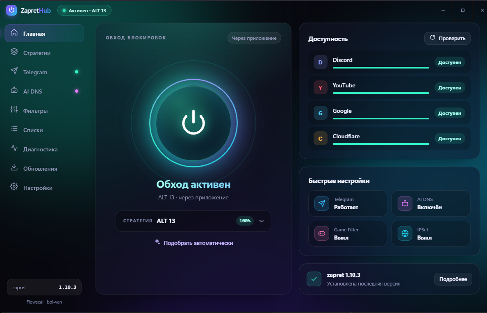
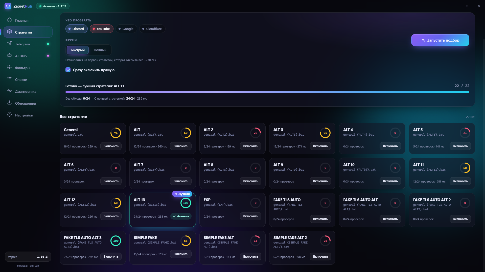
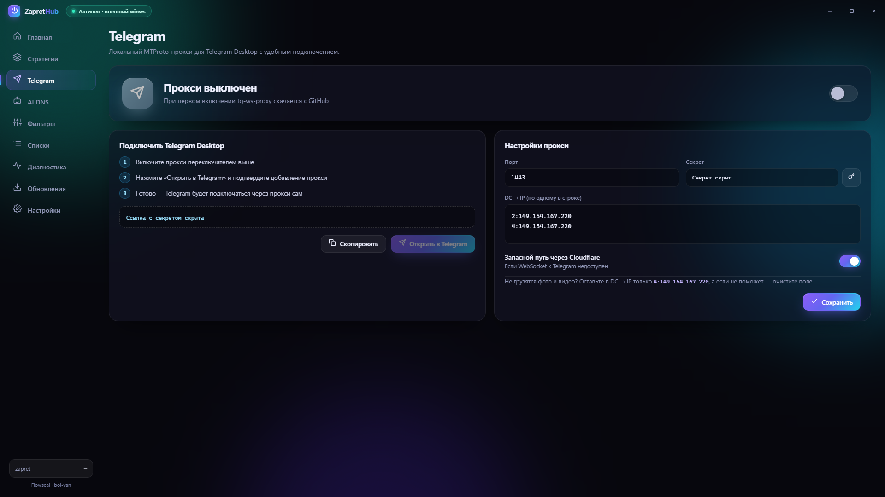
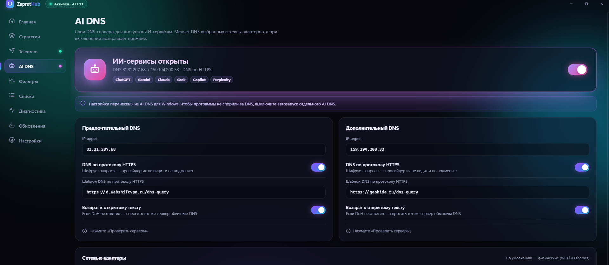
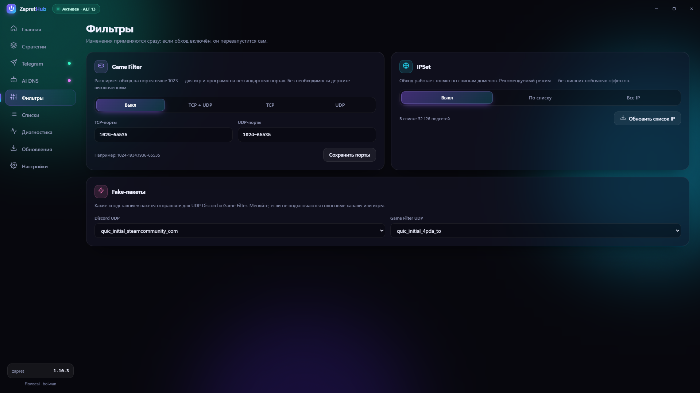
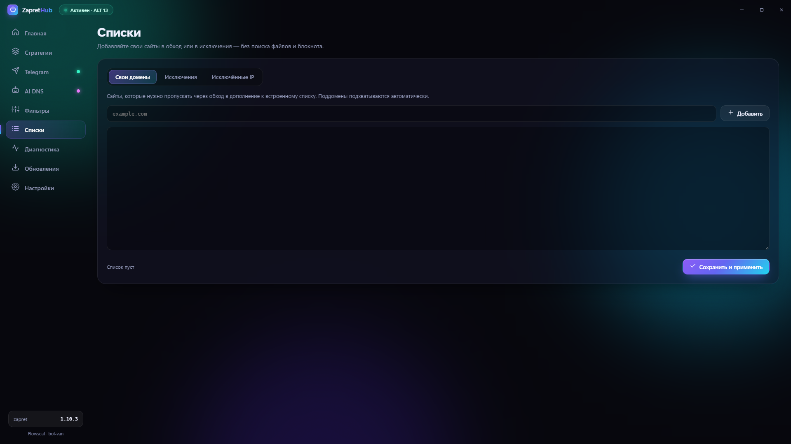
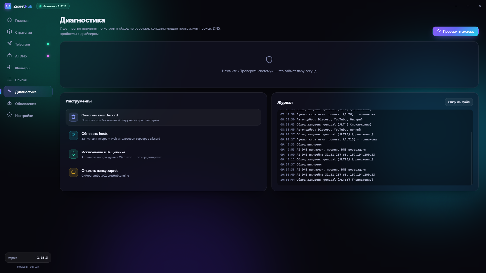
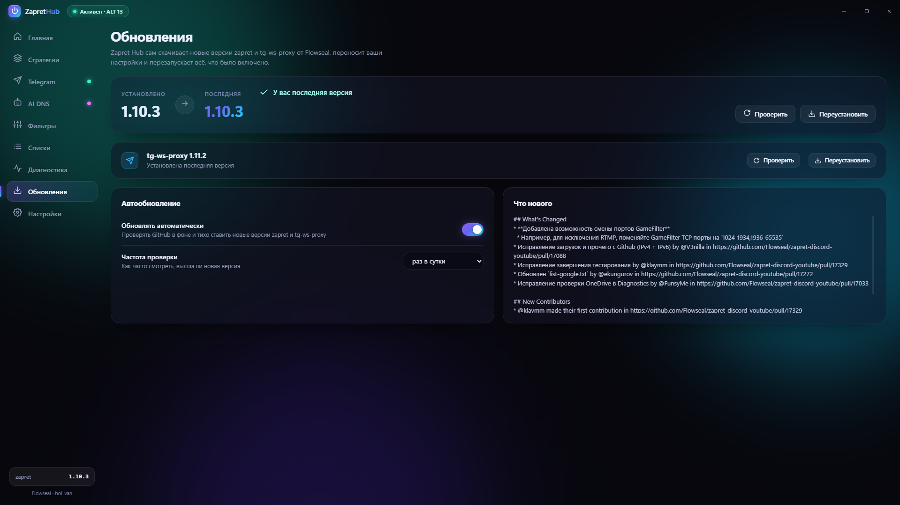
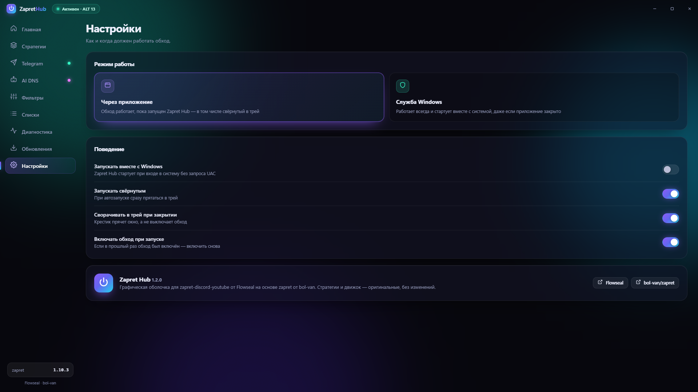

<div align="center">


# Zapret Hub

**Discord, YouTube, Telegram и AI DNS в одном приложении для Windows**

Включайте обход одной кнопкой, подбирайте рабочую стратегию автоматически и проверяйте доступность сервисов — без ручной правки скриптов.

   

**Разработчик: [Ebowsky](https://github.com/oilqwer)**

[**⬇ Скачать для Windows**](https://github.com/oilqwer/ZapretHub/releases/latest) &nbsp;·&nbsp; [Возможности](#возможности) &nbsp;·&nbsp; [Как запустить](#как-запустить) &nbsp;·&nbsp; [Обновления](#как-проверяются-обновления) &nbsp;·&nbsp; [Сборка](#сборка-и-документация)

</div>

<br />

<p align="center">
  
</p>

> Скриншоты в этом файле сделаны на версии 1.2.x. Интерфейс 2.0 сохранил это оформление, но отдельные экраны отличаются — например, «Обновления» и «Telegram» (в 2.0 Telegram-прокси встроен, обновления zapret идут напрямую с GitHub Flowseal). Новые скриншоты будут добавлены позже.

## Возможности

- **Обход одной кнопкой** — стратегии для Discord, YouTube и других сервисов; новые стратегии подхватываются при обновлении движка zapret.
- **Автоподбор стратегии** — приложение само проверяет стратегии и выбирает подходящую вашему провайдеру.
- **Telegram** — встроенный локальный прокси (MTProto поверх WebSocket, порт ядра [tg-ws-proxy](https://github.com/Flowseal/tg-ws-proxy) на C#) с подключением к Telegram Desktop в один клик; без отдельной загрузки.
- **AI DNS** — DNS-серверы для доступа к ИИ-сервисам, с возвратом прежних настроек.
- **Фильтры и списки** — Game Filter, IPSet, свои домены и исключения.
- **Диагностика** — проверка типичных проблем (BFE, прокси, TCP timestamps, конфликтующие программы, файлы движка), исключение Защитника Windows только по вашему согласию.
- **Обновления zapret** — напрямую с GitHub Flowseal, с переносом ваших списков и стратегии, резервной копией и откатом при ошибке.
- **Трей и автозапуск** — работа в фоне, запуск вместе с Windows без запроса UAC.

## Как это выглядит

**Автоматический подбор стратегий**



<table>
<tr>
<td width="50%" valign="top">
<strong>Telegram</strong><br />
Локальный прокси и настройки подключения. Секрет и ссылка на скриншоте скрыты.<br /><br />

</td>
<td width="50%" valign="top">
<strong>AI DNS</strong><br />
Выбор DNS-серверов и возврат прежних настроек.<br /><br />

</td>
</tr>
</table>

<details>
<summary><strong>Ещё скриншоты: фильтры, списки, диагностика, обновления, настройки</strong></summary>

<br />

**Фильтры**



**Свои списки и исключения**



**Диагностика**



**Обновления** (версия 1.2.x; в 2.0 здесь только zapret, Telegram-прокси встроен)



**Настройки**



</details>

## AI DNS: результаты тестирования

Проверки проведены вручную на двух компьютерах с версией 1.2.0; результат зависит от сети и условий доступа к сервисам.

| Сервис | Результат |
|---|---|
| ChatGPT | ✅ Работает |
| Claude AI | ✅ Работает |
| Gemini, отдельное приложение Windows | ✅ Работает |
| Gemini, сайт в браузере | ❌ Не работает в протестированных конфигурациях |

Точная причина проблемы с веб-версией Gemini не установлена, поэтому AI DNS не гарантирует доступ к ней через браузер. Подробнее — в [результатах тестирования](docs/AI-DNS-TESTING.md).

## Как запустить

1. Скачайте `ZapretHub.exe` на странице [Releases](https://github.com/oilqwer/ZapretHub/releases/latest) и проверьте SHA-256 по файлу `SHA256SUMS.txt`:
   ```powershell
   Get-FileHash .\ZapretHub.exe -Algorithm SHA256
   ```
2. Запустите файл и подтвердите запрос прав администратора (нужны для драйвера WinDivert).
3. При первом запуске приложение само скачает zapret с GitHub Flowseal — после этого включайте нужные функции.

**Требования:** Windows 10/11 x64, [Microsoft Edge WebView2 Runtime](https://developer.microsoft.com/microsoft-edge/webview2/) (в Windows 11 уже есть), интернет для первой загрузки zapret. Python не нужен. Для AI DNS через системный DoH требуется Windows 11.

> [!NOTE]
> `ZapretHub.exe` не имеет цифровой подписи издателя, поэтому SmartScreen и антивирусы могут показать предупреждение; сверяйте SHA-256. Данные приложения хранятся в `C:\ProgramData\ZapretHub` (движок, `settings.json`, журнал, резервная копия `engine.backup`).

## Как проверяются обновления

| Что | Источник | Проверка |
|---|---|---|
| Движок zapret | GitHub API `Flowseal/zapret-discord-youtube` (`releases/latest`) | HTTPS, репозиторий-владелец, **SHA-256 из поля `digest` ответа GitHub API**; без `digest` или при несовпадении установка отклоняется |
| Компоненты самого Zapret Hub | подписанный манифест `manifest/components.json` в этом репозитории | подпись **Ed25519** (публичный ключ зашит в программу), SHA-256, защита от отката (`sequence`) |

Подписи разработчика Flowseal программа не проверяет: у его релизов её нет, проверяется только SHA-256 из GitHub API. Архив распаковывается во временную папку с защитой от выхода за её пределы; прежний движок сохраняется в `engine.backup`, при ошибке выполняется откат. Сейчас собственных подписанных компонентов нет (манифест пуст), «Обновить hosts» в диагностике временно недоступно.

## Сборка и документация

- [Сборка](BUILDING.md) — .NET 8 SDK, одна команда `dotnet publish`, воспроизводимая сборка.
- [История изменений](CHANGELOG.md) · [AI DNS: тестирование](docs/AI-DNS-TESTING.md)
- [Сторонние уведомления](THIRD-PARTY-NOTICES.md) · [тексты лицензий](licenses/) · [Лицензия GPL-3.0](LICENSE)

## Авторство и лицензия

**Zapret Hub — самостоятельная Windows-программа, разработанная [Ebowsky](https://github.com/oilqwer).** Графический интерфейс, интеграция компонентов и логика управления относятся к проекту Zapret Hub и распространяются по лицензии **GPL-3.0-only** (см. [LICENSE](LICENSE)).

Сетевые движки и библиотеки принадлежат своим авторам: [zapret](https://github.com/bol-van/zapret) — bol-van, [zapret-discord-youtube](https://github.com/Flowseal/zapret-discord-youtube) и [tg-ws-proxy](https://github.com/Flowseal/tg-ws-proxy) — Flowseal; перечень остальных — в [уведомлениях](THIRD-PARTY-NOTICES.md). Zapret для Windows не входит в этот репозиторий и загружается программой из первоисточника.

Zapret Hub **не является официальным проектом** Flowseal, bol-van, Telegram, Discord или Google. Программа управляет сетевыми настройками вашего компьютера; используйте её в соответствии с законодательством вашей страны. Программа предоставляется «как есть», без гарантий.